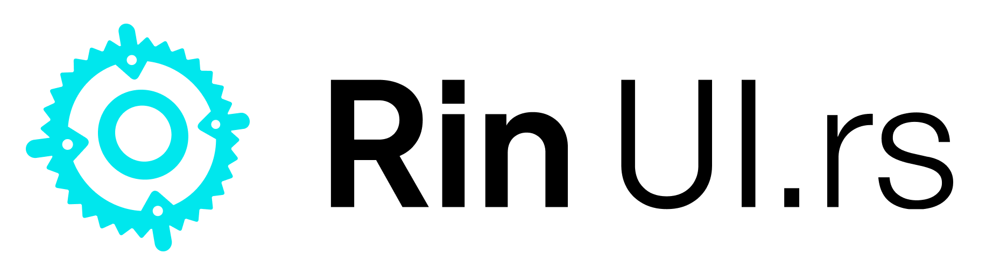
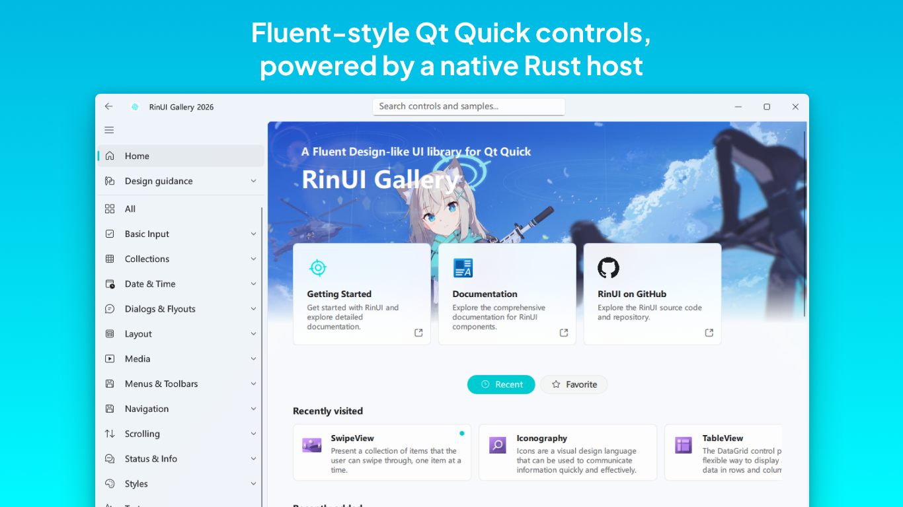
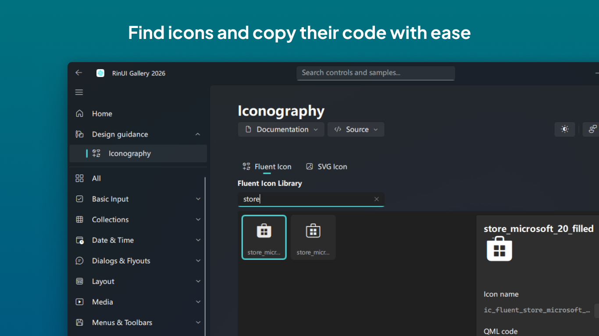
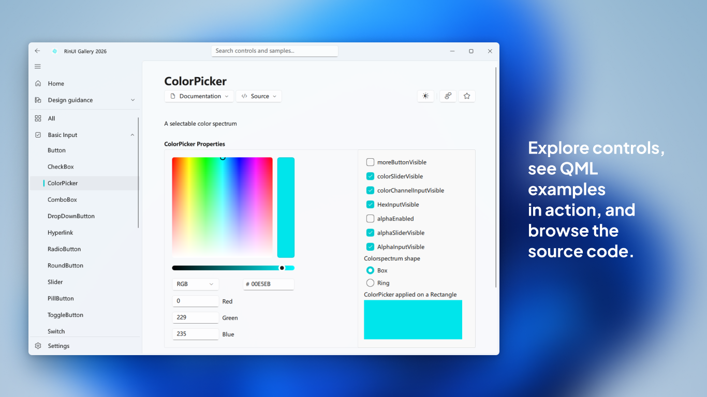
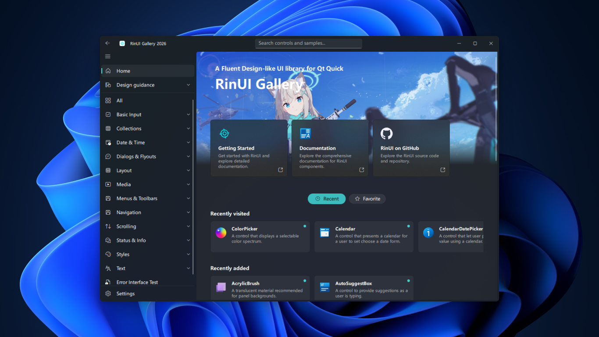
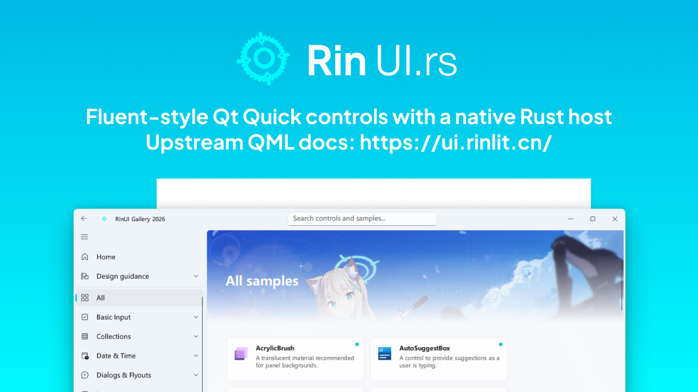

<div align="center">

<h1>
    <a href="https://github.com/unDefFtr/rinui-rs">
      <picture>
        <source
          media="(prefers-color-scheme: dark)"
          srcset="docs/img/logo-dark.png">
        
      </picture>
    </a>
</h1>

<p>
<span>A native Rust host for RinUI <br> built with Rust and Qt Quick</span>  &emsp;&emsp;
<b>English</b> | <a href="./docs/README_zhCN.MD">中文</a>
</p>

[](https://github.com/unDefFtr/rinui-rs)
[](https://github.com/unDefFtr/rinui-rs/releases)
[](https://github.com/unDefFtr/rinui-rs)
[](https://github.com/unDefFtr/rinui-rs/releases)

</div>

`rinui-rs` is an independent, reusable Rust / CXX-Qt 6 host for the Fluent-style Qt Quick (QML) components from [RinUI](https://github.com/RinLit-233-shiroko/Rin-UI).
It replaces the Python/PySide6 runtime with Rust + C++/Objective-C++ while retaining upstream QML components and themes. The pinned `upstream/Rin-UI` submodule remains unmodified.

Explore RinUI's Fluent-inspired Qt Quick/QML controls through interactive samples, documentation, icons, and source links.

### Screenshots


<details style="text-align: center">
<summary>More screenshots...</summary>





</details>


<p align="center">
    <a href="https://apps.microsoft.com/detail/9NJGH90NLXDM?referrer=appbadge&mode=full" target="_blank"  rel="noopener noreferrer">
        <picture>
        <source
          media="(prefers-color-scheme: dark)"
          srcset="https://get.microsoft.com/images/en-us%20light.svg">
        
      </picture>
    </a>
</p>

> The store link above opens the upstream RinUI Gallery (PySide version). Build this repository's Rust Gallery from source using the instructions below.

> The image in the banner comes from Pixiv, PID: [125975786](https://www.pixiv.net/artworks/125975786)


> [!NOTE]
> This repository is `rinui-rs` (`0.1.0-alpha.2`). The documentation layout is adapted from upstream RinUI; branding and selected screenshots have been updated for this repository.

### Features
* Elegant Fluent Design controls (WIP)
* Dark and light mode, automatic switching
* Compatible with original QML control names
* i18n Internationalization
* Native Rust / CXX-Qt host with no Python/PySide6 runtime
* Embedded QRC and developer filesystem resource modes
* Windows, macOS, and Linux platform integration
* Theme system (WIP)
* [RinUI-rs documentation](https://rinui-rs.undef.work/) for Rust integration and QML components

## 🪄 Usage

Build with Rust (MSRV `1.88`), a C++ toolchain, and Qt 6 with `Qt5Compat` and `QtShaderTools`. Set `QMAKE` to your Qt 6 `qmake` executable if it is not on `PATH`.

- **Windows**: MSVC Build Tools 2022 and the Rust MSVC toolchain.
- **macOS**: Xcode Command Line Tools. Apple Silicon with Xcode 26 and Qt `< 6.11.1` also requires `CXXFLAGS="-include arm_acle.h"`.
- **Linux**: GCC/Clang, Qt's X11/Wayland development dependencies, and `lld` (or `gold`/`mold`) for linking.

Clone the repository with its upstream submodule, then run the Gallery:

```bash
git clone --recurse-submodules https://github.com/unDefFtr/rinui-rs
cd rinui-rs
cargo run -p rinui-gallery

# Developer mode: load QML from upstream/Rin-UI on each launch
cargo run -p rinui-gallery -- --dev
```

For an existing checkout, initialize the submodule with `git submodule update --init --recursive`.

Import RinUI in your QML file:

```qmllang
import RinUI
```

Add `rinui-host = "0.1.0-alpha.2"` to your application's `[dependencies]`. The crate bundles the native bridges and upstream QML, so applications can build without cloning the submodule. Use it to load your QML from Rust.

```rust
use rinui_host::{HostConfig, QmlSource, RinUIHost};
use std::process::ExitCode;

fn run() -> Result<i32, Box<dyn std::error::Error>> {
    let mut host = RinUIHost::new(HostConfig::default())?;
    host.load(&QmlSource::File("/path/to/your/file.qml".into()))?;
    Ok(host.exec())
}

fn main() -> ExitCode {
    match run() {
        Ok(code) => ExitCode::from((code & 0xFF) as u8),
        Err(err) => {
            eprintln!("error: {err}");
            ExitCode::FAILURE
        }
    }
}
```

See the [Gallery host](./examples/gallery/src/main.rs) and [engine configuration example](./crates/rinui-host/examples/engine_config_demo.rs) for integration details. On macOS, the Gallery uses QML window controls by default; pass `--upstream-mac-frame` to opt into the native titlebar.

To test and build a release:

```bash
cargo test --workspace
cargo build --release -p rinui-gallery
```

Desktop packaging scripts are available for [macOS](./scripts/package_macos.sh), [Windows](./scripts/package_windows.ps1), [MSIX](./scripts/package_msix.ps1), and [Linux](./scripts/package_linux.sh).

> [!NOTE]
> The [upstream documentation](https://ui.rinlit.cn/) describes RinUI's QML components and themes. Its Python/PySide installation and startup instructions apply to upstream RinUI; use the Rust host workflow above for this repository.

## 🙌 Acknowledgements
### Resources
- [RinUI](https://github.com/RinLit-233-shiroko/Rin-UI) (upstream QML components, themes, and documentation)
- [Qt Quick](https://www.qt.io/)
- [CXX-Qt](https://github.com/KDAB/cxx-qt)
- [Fluent Design System](https://fluent2.microsoft.design/)
- [Fluent UI System Icons](https://github.com/microsoft/fluentui-system-icons/)
- [WinUI 3 Gallery](https://github.com/microsoft/WinUI-Gallery)

### Contributors
Contributions are welcome through this repository's [Issues](https://github.com/unDefFtr/rinui-rs/issues) and [Pull Requests](https://github.com/unDefFtr/rinui-rs/pulls).

Thanks to the upstream RinUI author and contributors:
[](https://github.com/RinLit-233-shiroko/Rin-UI/graphs/contributors)

## 📜 License
This project is licensed under the **MIT** License, you can learn more about it in the [license file](./LICENSE).

Rust host code: Copyright © 2026 unDefFtr.
Upstream RinUI and reused documentation/images: Copyright © 2025 RinLit.
See [THIRD_PARTY_NOTICES.md](./THIRD_PARTY_NOTICES.md) for third-party licenses.

##

`rinui-rs` is in Alpha. Suggestions and contributions are welcome. ❤️
