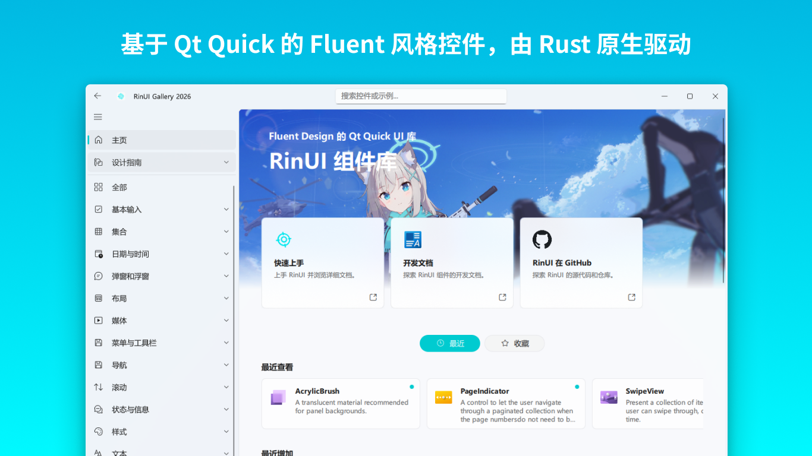
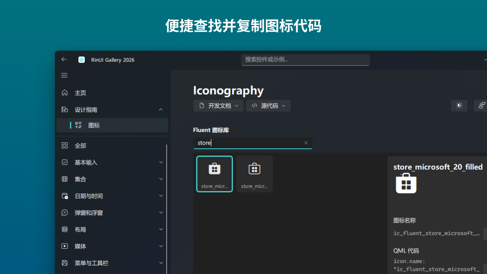
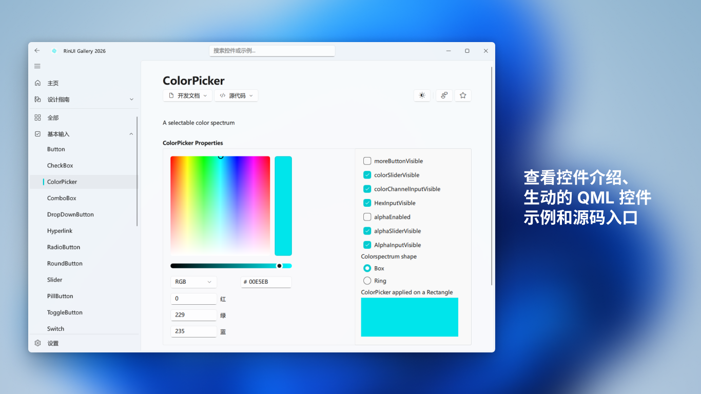
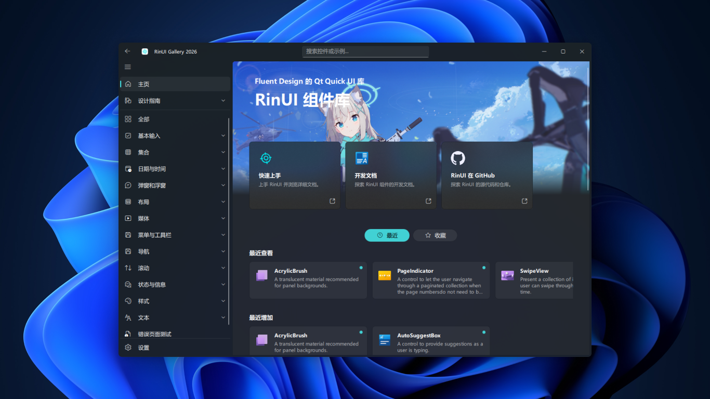
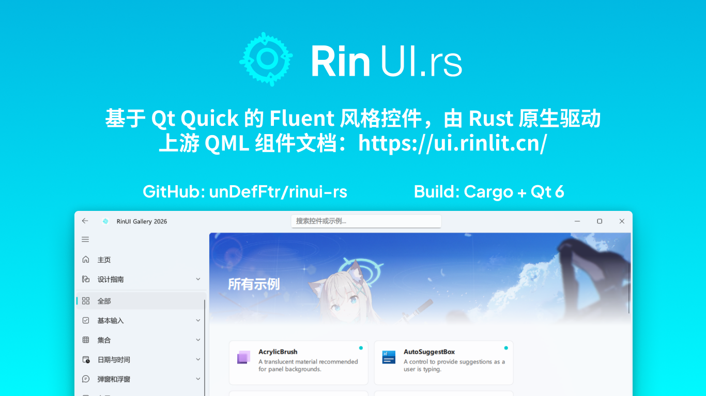

<div align="center">

<h1>
    <a href="https://github.com/unDefFtr/rinui-rs">
      <picture>
        <source
          media="(prefers-color-scheme: dark)"
          srcset="img/logo-dark.png">
        
      </picture>
    </a>
</h1>

<p>
<span>基于 Rust 和 Qt Quick 构建的<br>RinUI 原生宿主层</span>  &emsp;&emsp;
<b>中文</b> | <a href="../README.md">English</a>
</p>

[](https://github.com/unDefFtr/rinui-rs)
[](https://github.com/unDefFtr/rinui-rs/releases)
[](https://github.com/unDefFtr/rinui-rs)
[](https://github.com/unDefFtr/rinui-rs/releases)

</div>

`rinui-rs` 为上游 [RinUI](https://github.com/RinLit-233-shiroko/Rin-UI) 的 Fluent 风格 Qt Quick (QML) 组件提供独立、可复用的 Rust / CXX-Qt 6 宿主层。
以 Rust + C++/Objective-C++ 替代 Python/PySide6 运行时，保留上游 QML 组件与主题，并将 `upstream/Rin-UI` 作为锁定提交的子模块保持不变。

RinUI Gallery 用交互式示例浏览 RinUI 的 Fluent 风格 Qt Quick/QML 控件，查看组件说明、图标和源码入口。

### 截图展示


<details style="text-align: center">
<summary>更多截图...</summary>





</details>

<p align="center">
    <a href="https://apps.microsoft.com/detail/9NJGH90NLXDM?referrer=appbadge&mode=full" target="_blank"  rel="noopener noreferrer">
        <picture>
        <source
          media="(prefers-color-scheme: dark)"
          srcset="https://get.microsoft.com/images/zh-cn%20light.svg">
        
      </picture>
    </a>
</p>

> 上方商店入口指向上游 RinUI Gallery（PySide 版本）；本仓库的 Rust Gallery 请通过下方源码流程构建。

> 横幅中的图片来自 Pixiv，PID：[125975786](https://www.pixiv.net/artworks/125975786)

> [!NOTE]
> 本仓库为 `rinui-rs`（`0.1.0-alpha.1`）。文档结构改编自上游 RinUI，项目标识与部分截图已更新为本仓库版本。

### 特性
* 优雅的 Fluent Design 控件（WIP）
* 深浅色模式以及自动切换
* 兼容原版 QML 控件名
* 国际化支持
* Rust / CXX-Qt 原生宿主，无需 Python/PySide6 运行时
* 内嵌 QRC 与开发文件系统两种资源模式
* Windows、macOS、Linux 平台适配
* 主题系统（WIP）
* 上游 QML 组件文档，[现在可以在此预览](https://ui.rinlit.cn/)

## 🪄 使用方法

从源码构建需要 Rust（MSRV `1.85`）、C++ 工具链，以及包含 `Qt5Compat` 和 `QtShaderTools` 的 Qt 6。若 Qt 6 的 `qmake` 不在 `PATH` 中，请设置 `QMAKE` 指向它。

- **Windows**：MSVC Build Tools 2022 和 Rust MSVC 工具链。
- **macOS**：Xcode Command Line Tools。Apple Silicon + Xcode 26 搭配 Qt `< 6.11.1` 时，还需设置 `CXXFLAGS="-include arm_acle.h"`。
- **Linux**：GCC/Clang、Qt 所需的 X11/Wayland 开发依赖，以及用于链接的 `lld`（或 `gold`/`mold`）。

克隆仓库及上游子模块，然后运行 Gallery：

```bash
git clone --recurse-submodules https://github.com/unDefFtr/rinui-rs
cd rinui-rs
cargo run -p rinui-gallery

# 开发模式：每次启动从 upstream/Rin-UI 加载 QML
cargo run -p rinui-gallery -- --dev
```

已有仓库可通过 `git submodule update --init --recursive` 初始化子模块。

在你的 QML 文件中导入 RinUI：

```qmllang
import RinUI
```

在 Rust 中使用工作区的 `rinui-host` crate 加载 QML：

```rust
use rinui_host::{HostConfig, QmlSource, RinUIHost};
use std::process::ExitCode;

fn run() -> Result<i32, Box<dyn std::error::Error>> {
    let mut host = RinUIHost::new(HostConfig::default())?;
    host.load(&QmlSource::File("/path/to/your/file.qml".into()))?;
    Ok(host.exec())
}

fn main() -> ExitCode {
    match run() {
        Ok(code) => ExitCode::from((code & 0xFF) as u8),
        Err(err) => {
            eprintln!("error: {err}");
            ExitCode::FAILURE
        }
    }
}
```

接入方式可参考 [Gallery 宿主](../examples/gallery/src/main.rs)和[引擎配置示例](../crates/rinui-host/examples/engine_config_demo.rs)。macOS 上 Gallery 默认使用 QML 自绘窗口控件，传入 `--upstream-mac-frame` 可启用原生标题栏。

测试与发布构建：

```bash
cargo test --workspace
cargo build --release -p rinui-gallery
```

桌面打包脚本：[macOS](../scripts/package_macos.sh)、[Windows](../scripts/package_windows.ps1)、[MSIX](../scripts/package_msix.ps1)、[Linux](../scripts/package_linux.sh)。

> [!NOTE]
> [上游在线文档](https://ui.rinlit.cn/)介绍 RinUI 的 QML 组件和主题，其中 Python/PySide 安装与启动说明适用于上游项目；本仓库请使用上述 Rust 宿主流程。

## 🙌 致谢
### 资源
- [RinUI](https://github.com/RinLit-233-shiroko/Rin-UI)（上游 QML 组件、主题与文档）
- [Qt Quick](https://www.qt.io/)
- [CXX-Qt](https://github.com/KDAB/cxx-qt)
- [Fluent Design System](https://fluent2.microsoft.design/)
- [Fluent UI System Icons](https://github.com/microsoft/fluentui-system-icons/)
- [WinUI 3 Gallery](https://github.com/microsoft/WinUI-Gallery)

### 贡献者
欢迎通过本仓库的 [Issues](https://github.com/unDefFtr/rinui-rs/issues) 和 [Pull Requests](https://github.com/unDefFtr/rinui-rs/pulls) 提出建议或贡献代码。

感谢上游 RinUI 的作者和贡献者：
[](https://github.com/RinLit-233-shiroko/Rin-UI/graphs/contributors)

## 📜 许可证
本项目采用 **MIT** 许可证，你可以在[许可证文件](../LICENSE)中了解更多信息。

Rust 宿主代码：Copyright © 2026 unDefFtr。
上游 RinUI 与沿用文档、图片：Copyright © 2025 RinLit。
第三方组件许可见 [THIRD_PARTY_NOTICES.md](../THIRD_PARTY_NOTICES.md)。

##

`rinui-rs` 仍处于 Alpha 阶段，欢迎提出建议并贡献代码。❤️
